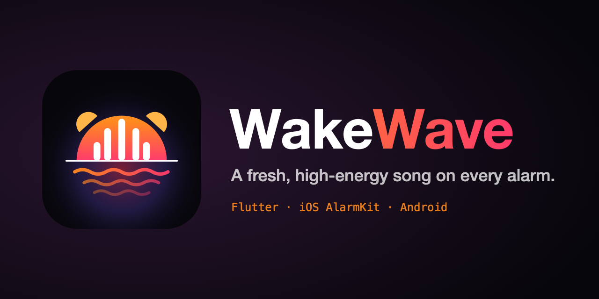
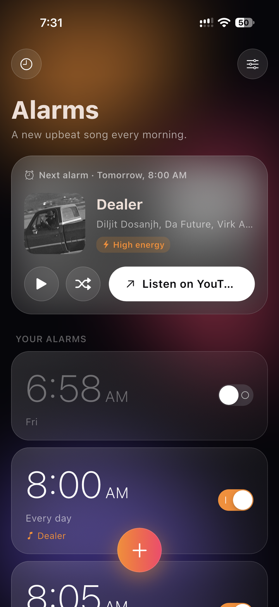
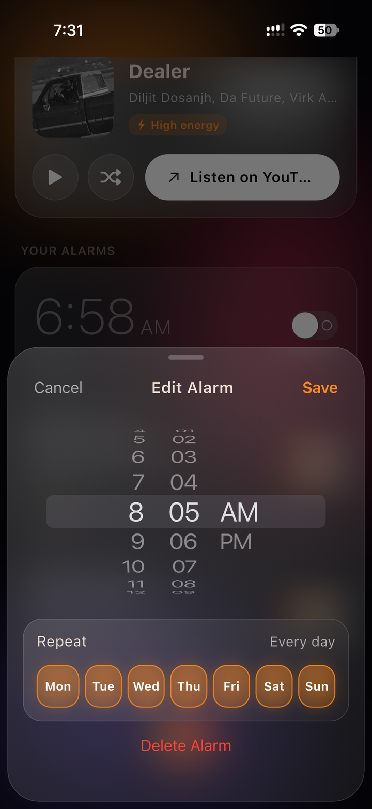
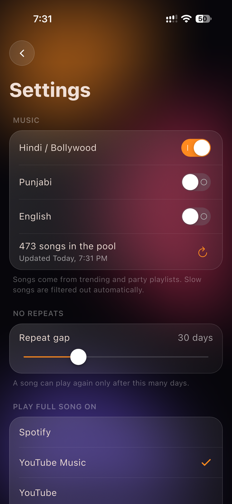

<p align="center">
  
</p>

<p align="center">
  <b>Wake up to a different song every single morning.</b><br>
  An open-source alarm clock for iPhone and Android that picks a fresh, upbeat Hindi, Punjabi or English track for every ring and starts it right at the hook.
</p>

<p align="center">
  
  
  
  
</p>

---

## Why WakeWave?

The same alarm tone every day stops working. Your brain learns it, tunes it out, and the snooze button wins.
Music apps can play a song at a set time, but they need to stay open, they don't ring like a real alarm when the
phone is locked, and you still have to pick the song yourself.

WakeWave fixes that:

- **A new song on every ring.** Every alarm, every day gets its own track, and a song won't repeat for 30 days (you can change the gap).
- **Only songs that wake you up.** Each candidate is scored for energy from its audio; slow and romantic tracks are dropped automatically.
- **Starts at the best part.** The alarm clip begins at the loudest 6-second window of the song (the hook), not the quiet intro.
- **Rings like a real alarm.** It uses the operating system's own alarm system (AlarmKit on iOS, AlarmManager + a full-screen ring screen on Android), so it rings on the lock screen, in silent mode, with the app closed.
- **Liked the song? Play it in full.** One tap on "Full Song" opens it in Spotify, YouTube Music, YouTube, JioSaavn or Apple Music — your choice.
- **Fresh charts, no setup.** The song pool comes from trending public playlists (Hindi, Punjabi, English — pick any mix), refreshed every few days.
- **Works offline at night.** Songs for the next 7 days are downloaded ahead of time, so nothing needs the internet when the alarm goes off.

## Screenshots

| Home | Edit alarm | Settings |
| :---: | :---: | :---: |
|  |  |  |

## How it works

```
Trending public playlists ──► song pool (Hindi / Punjabi / English)
                                   │
                                   ▼
            find a 30 s official preview (iTunes → Spotify → JioSaavn hook clip)
                                   │
                                   ▼
          energy score from the audio  ──►  too slow? drop it
                                   │
                                   ▼
            cut the clip at the loudest 6 s window (the hook)
                                   │
                                   ▼
   one one-shot OS alarm per ring for the next 7 days, each with its own song
```

- **Scheduling (`lib/engine.dart`)** — every ring in the next 7 days becomes its own one-shot system alarm with its own sound file.
  No background task has to wake up at night; opening the app once in a while tops the schedule up.
- **Never miss a ring** — if a song is still downloading when a ring is close, the ring is handed to the OS straight away with an
  already-prepared song (or the system sound), then upgraded when the download finishes.
- **No wasted downloads** — when you edit, switch off or delete an alarm, its unused songs go to a stash and are reused by the next rings.
- **Energy filter** — native code (`ios/Runner/AppDelegate.swift`, `android/.../Energy.kt`) decodes each preview and scores how loud and
  punchy it is. Party tracks score around 3, romantic ballads around 1.5; anything under 1.95 is skipped.
- **Song pool (`lib/catalog.dart`)** — public playlist track lists, matched to official 30-second previews from the Apple iTunes Search API,
  with Spotify's preview and JioSaavn's short JioTune clip as fallbacks. Album art is cached so the ring screen works offline.

## Tech stack

| Layer | What |
| --- | --- |
| App & UI | Flutter (Dart), custom "liquid glass" dark UI |
| iOS alarms | AlarmKit (iOS 26+), Swift |
| Android alarms | AlarmManager exact alarms, foreground service, full-screen lock-screen activity, Kotlin |
| Audio analysis | AVFoundation (iOS) / MediaCodec (Android) |
| Data | Local JSON state, no account, no server, no tracking |

## Project structure

```
lib/
  main.dart      UI (home, alarm editor, settings, ring history)
  engine.dart    scheduling, song assignment, stash, downloads
  catalog.dart   playlists, preview lookup, artwork
  models.dart    alarms, songs, settings
  native.dart    method channel to iOS / Android
ios/Runner/AppDelegate.swift              AlarmKit scheduling + energy scoring
android/app/src/main/kotlin/.../          AlarmScheduler, AlarmService, AlarmActivity, Energy, Art
tool/catalog_check.dart                   sanity check for playlist + preview matching
```

## Build it yourself

You need Flutter 3.x. For Android: JDK 17 and the Android SDK. For iPhone: a Mac with Xcode and an Apple ID.

```bash
git clone https://github.com/harshitbhatiayt/WakeWave.git
cd WakeWave
flutter pub get

# Android
flutter build apk --release        # -> build/app/outputs/flutter-apk/app-release.apk

# iPhone (iOS 26+): open ios/Runner.xcworkspace in Xcode once,
# set your own Team under Signing & Capabilities, then:
flutter run --release -d <your-iphone>

# Optional: check that playlists resolve to previews
dart run tool/catalog_check.dart
```

> **iPhone note:** with a free Apple ID the app has to be re-installed every 7 days. A paid developer account removes that limit.
>
> **Android note:** open the app once after installing, and allow notifications (and full-screen alerts if your phone asks) so alarms can ring on the lock screen.

## Download

Ready-made Android APKs are attached to each [GitHub Release](../../releases).

## Roadmap

- [ ] Option: same song for every alarm on the same day (fewer downloads)
- [ ] More languages and genres
- [ ] Home-screen widget showing the next alarm's song
- [ ] Gentle volume ramp-up

Ideas and pull requests are welcome — open an [issue](../../issues).

## Disclaimer

WakeWave is a personal, non-commercial open-source project. It is **not affiliated with or endorsed by** Spotify, Apple, JioSaavn,
YouTube or any record label. It only plays the short official preview clips these services make publicly available and never
downloads full tracks — the "Full Song" button sends you to the official app. All songs, artwork and trademarks belong to their owners.
These services can change or restrict their public endpoints at any time, which may break song lookup.

## License

[MIT](LICENSE) © 2026 Harshit Bhatia

<p align="center">Made with ☀️ by <a href="https://www.youtube.com/@HarshitTechnicalYT">Harshit Technical</a></p>
